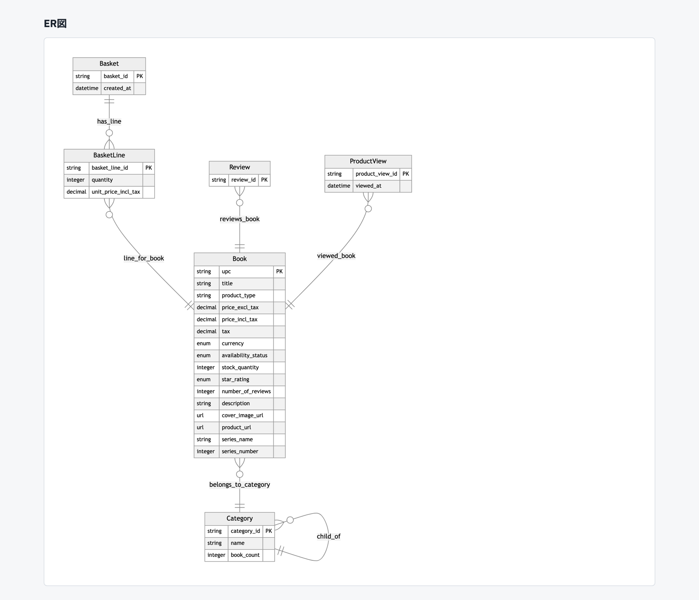
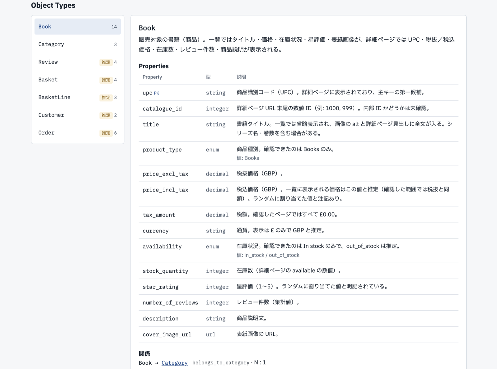
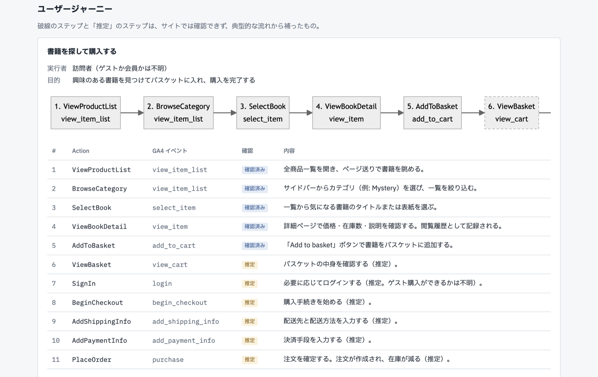
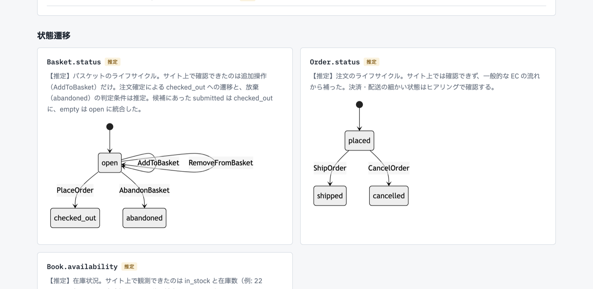

# ontogen

Webサイトを解析して、ディスカバリー（初回ヒアリング前）用のオントロジー叩き台を自動生成するプロトタイプ。
Palantir Foundry の Object Type / Property / Link Type / Action Type に沿って出力する。
あわせて、ユーザーが目的を達成するまでの流れ（ユーザージャーニー）と、Basket や Order の状態遷移も出力する。
ジャーニーの各ステップには、対応する GA4 の推奨イベント名（`view_item`、`add_to_cart`、`purchase` など）を付ける。

## 画面

`ontogen run` を実行すると、生成したオントロジーを見るための画面（`out/<slug>/viewer.html`）が出力される。
ブラウザで直接開ける。次の画像は books.toscrape.com から生成した例。

ER図で Object Type どうしの関係を確認できる。



左の一覧で Object Type を選ぶと、プロパティ・関係・根拠（引用元のページ）が右に出る。
画面に表示されていない概念（Basket など）には「推定」のラベルが付く。



ユーザージャーニーでは、目的を達成するまでのステップを、対応する GA4 のイベント名とあわせて順に示す。
サイトで確認できなかったステップは、破線と「推定」のラベルで区別する。
books.toscrape.com ではカートに入れるところまでしか確認できないので、購入手続きから注文確定までは推定になっている。



状態遷移では、Basket や Order などが取りうる状態と、どの Action で状態が移るかを示す。



このほか、Action Type の一覧と、ヒアリングで確認すべき事項も同じ画面に並ぶ。

## 仕組み

```
クロール（同一ホスト・URLパターンごとに代表ページだけ取得、robots.txt 準拠）
  → ページ要約（見出し・表・フォーム・パンくず・JSON-LD・class 属性・画像の alt 属性・GTM/GA4 の計測タグ）
  → [LLM] ページパターンごとに概念候補を抽出
  → [LLM] 候補を統合・名寄せし、GA4 の推奨イベントを参照してジャーニーと状態遷移を組み立てる
  → 根拠引用の照合（ハルシネーション検知）
  → YAML / Mermaid ER図 / Markdownレポート
```

LLM は Claude Code のヘッドレスモード（`claude -p --json-schema`）で呼ぶため、APIキーは不要（Claude Code のログインを使う）。
環境変数 `ANTHROPIC_API_KEY` があると、そちらがログインより優先されてしまうので、子プロセスに渡す前に取り除いている。

## 使い方

```bash
uv sync
uv run ontogen run https://books.toscrape.com/index.html --out out/books --gold gold/books_toscrape.yaml
uv run ontogen run https://webscraper.io/test-sites/e-commerce/allinone --out out/webscraper --gold gold/webscraper_allinone.yaml
uv run ontogen eval out/books/ontology.yaml gold/books_toscrape.yaml
```

出力（`--out` 配下）:

| ファイル | 内容 |
|---|---|
| `viewer.html` | オントロジーの画面。ブラウザで直接開く（ER図の描画に CDN の mermaid を読み込むので、ネットワーク接続が必要） |
| `report.md` | 顧客説明用レポート（ER図、各定義、ヒアリング事項、根拠の検証結果） |
| `ontology.yaml` | オントロジー本体（根拠URL・引用付き） |
| `ontology.mmd` | Mermaid ER図 |
| `fragments/` | ページパターンごとの抽出候補（統合前） |
| `pages.json` | クロール結果のキャッシュ（`--recrawl` で取り直す） |
| `llm_cache/` | LLM 応答のキャッシュ（プロンプトが同じなら再利用） |

## 評価

`gold/*.yaml` に人手で作った正解を置き、Object / Property / Link / Action ごとに適合率と再現率を出す。
書式は `gold/books_toscrape.yaml` の冒頭コメントを参照。
